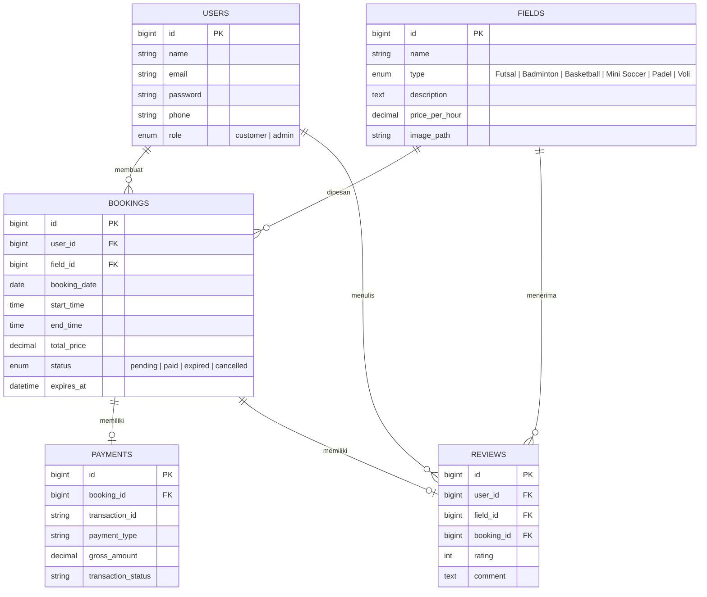
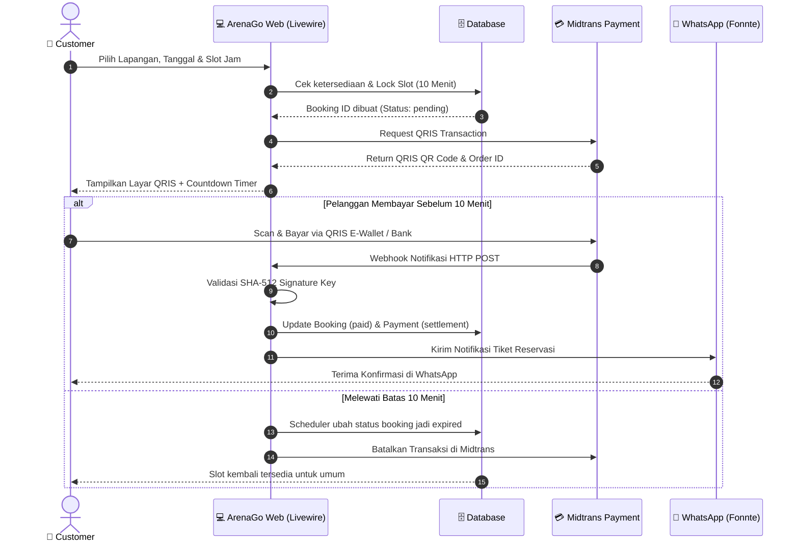

# ArenaGo - Sports Venue Booking & Management System

<p align="center">
  
</p>

<p align="center">
  <strong>Platform Web Modern Pemesanan Lapangan Olahraga Real-time dengan Pembayaran Otomatis QRIS & Notifikasi WhatsApp</strong>
</p>

<p align="center">
  
  
  
  
  
  
</p>

---

## 📌 Tentang ArenaGo

**ArenaGo** adalah aplikasi berbasis web yang dirancang untuk mempermudah proses reservasi dan manajemen fasilitas olahraga (seperti Futsal, Badminton, Basket, Mini Soccer, Padel, dan Voli). 

Platform ini menghubungkan para pengguna/pecinta olahraga dengan pengelola venue olahraga secara digital. Pengguna dapat mengecek ketersediaan jadwal secara langsung (*real-time calendar*), memesan slot tanpa antre, melakukan pembayaran instan melalui **QRIS (Midtrans)** dengan batas waktu 10 menit, serta mendapatkan konfirmasi reservasi otomatis melalui pesan **WhatsApp**.

Bagi pengelola (Admin), ArenaGo menyediakan dasbor analitik komprehensif untuk memantau pendapatan, mengelola katalog lapangan, serta memonitor seluruh jadwal dan transaksi sewa lapangan.

---

## 🚀 Fitur-Fitur Utama

### 👤 Pengguna (Customer / Pemesan)
- **Katalog Lapangan Olahraga:** Eksplorasi berbagai pilihan lapangan olahraga lengkap dengan deskripsi, spesifikasi, foto, rating ulasan, dan tarif per jam.
- **Kalender Jadwal Interaktif (Livewire):** Pengecekan ketersediaan jam bermain (jam operasional 08:00 - 22:00) secara instan tanpa reload halaman.
- **Pemilihan Slot Berurutan:** Mendukung reservasi fleksibel mulai dari 1 jam hingga 5 jam berurutan dalam sekali transaksi.
- **Proteksi Penguncian Slot (10-Minute Lock):** Saat slot dipilih dan masuk ke tahap checkout, sistem mengunci slot tersebut selama 10 menit guna menghindari perebutan slot (*race condition* / bentrok reservasi) dengan pengguna lain.
- **Pembayaran Instan via QRIS:** Generate QR Code QRIS otomatis melalui Payment Gateway **Midtrans** (Core API / Snap) yang dilengkapi timer hitung mundur (*countdown timer*).
- **Simulasi Pembayaran (Environment Lokal):** Tombol simulasi pembayaran instan untuk mempermudah pengujian saat mode pengembangan.
- **Notifikasi WhatsApp Otomatis:** Begitu pembayaran terverifikasi lunas, sistem mengirimkan pesan rincian tiket reservasi ke nomor WhatsApp pelanggan melalui integrasi **Fonnte API**.
- **Riwayat & Status Booking:** Pelanggan dapat memantau status pemesanan (`pending`, `paid`, `expired`, `cancelled`) kapan saja.
- **Sistem Rating & Ulasan:** Pelanggan yang telah menyelesaikan booking berbayar dapat memberikan rating bintang (1-5) dan review untuk fasilitas lapangan yang disewa.
- **Keamanan Akun:** Dilengkapi otentikasi aman berbasis Laravel Fortify, manajemen profil, opsi Two-Factor Authentication (2FA), dan dukungan Passkeys.

### 🛡️ Pengelola (Administrator)
- **Dashboard Analitik:** Ringkasan metrik performa bisnis, mencakup total pendapatan kotor (*gross revenue*), jumlah lapangan aktif, dan total reservasi aktif.
- **Manajemen Lapangan (CRUD):** Tambah lapangan baru, perbarui informasi tarif atau tipe olahraga, upload foto lapangan, serta hapus lapangan yang tidak lagi beroperasi.
- **Monitoring Seluruh Reservasi:** Tinjau status seluruh transaksi dan reservasi pelanggan secara mendetail beserta status pembayarannya.

### ⚙️ Sistem & Otomasi Backend
- **Anti Double-Booking:** Menggunakan **Database Transaction** dengan **Pessimistic Locking** (`lockForUpdate()`) guna menjamin konsistensi data saat terjadi transaksi bersamaan di milidetik yang sama.
- **Scheduler Pembatalan Otomatis (Cron Job):** Laravel Task Scheduling mengecek booking berstatus `pending` yang melampaui batas 10 menit setiap menitnya, mengubah statusnya menjadi `expired`, dan membatalkan tagihan di Midtrans.
- **Keamanan Webhook:** Verifikasi **SHA-512 Signature Key** dari callback Midtrans untuk mencegah manipulasi atau pemalsuan data pembayaran.

---

## 🛠️ Tech Stack & Arsitektur

| Komponen | Teknologi |
|---|---|
| **Backend Framework** | [Laravel 13](https://laravel.com/) (PHP 8.3 / 8.4) |
| **Frontend Reactive** | [Livewire 3 / 4](https://livewire.laravel.com/) & [Livewire Flux](https://flux.livewire.com/) |
| **Styling & Design** | [Tailwind CSS](https://tailwindcss.com/) & Dark-Themed UI |
| **Database & ORM** | MySQL / SQLite dengan Eloquent ORM |
| **Payment Gateway** | [Midtrans](https://midtrans.com/) (Snap & Core API QRIS) |
| **WhatsApp Gateway** | [Fonnte API](https://fonnte.com/) |
| **Task Scheduling** | Laravel Console Scheduler |
| **Containerization** | Docker & Alpine Linux (PHP-FPM) |

---

## 🗄️ Skema Basis Data (Database Schema)

Sistem menggunakan relasi data terstruktur yang memprioritaskan integritas relasi antar entitas:



---

## 🔄 Alur Kerja Sistem (Workflow)



---

## 💻 Panduan Instalasi & Menjalankan Proyek

Ikuti langkah-langkah di bawah ini untuk menjalankan ArenaGo di komputer lokal Anda:

### 1. Prasyarat Sistem
Pastikan perangkat Anda telah terpasang:
- **PHP >= 8.3** (beserta ekstensi: `pdo`, `mbstring`, `openssl`, `curl`, `gd`, `bcmath`, `zip`)
- **Composer** (versi terbaru)
- **Node.js** (v18+ atau v20+) & **NPM**
- **MySQL** atau **SQLite**
- **Git**

### 2. Kloning Repository
```bash
git clone https://github.com/banqditto/ArenaGo.git
cd ArenaGo
```

### 3. Instal Dependensi Backend & Frontend
```bash
# Instal dependensi PHP
composer install

# Instal dependensi Node.js
npm install
```

### 4. Konfigurasi Environment File
Salin berkas contoh konfigurasi `.env.example` menjadi `.env`:
```bash
# Windows PowerShell
copy .env.example .env

# Linux / macOS
cp .env.example .env
```

Buka berkas `.env` dan sesuaikan pengaturan utama:
```env
APP_NAME=ArenaGo
APP_URL=http://localhost:8000

# Pengaturan Database (Gunakan sqlite atau mysql)
DB_CONNECTION=sqlite
# Atau jika menggunakan MySQL:
# DB_CONNECTION=mysql
# DB_HOST=127.0.0.1
# DB_PORT=3306
# DB_DATABASE=arenago
# DB_USERNAME=root
# DB_PASSWORD=

# Pengaturan Midtrans (Sandbox / Production)
MIDTRANS_SERVER_KEY=your-midtrans-server-key
MIDTRANS_CLIENT_KEY=your-midtrans-client-key
MIDTRANS_IS_PRODUCTION=false

# Pengaturan Notifikasi WhatsApp (Fonnte API Token)
FONNTE_TOKEN=your-fonnte-api-token
```

### 5. Generate Application Key & Tautkan Storage
```bash
php artisan key:generate
php artisan storage:link
```

### 6. Migrasi & Seeding Database
Jalankan migrasi tabel beserta data awal (lapangan default dan akun pengguna demonstrasi):
```bash
php artisan migrate --seed
```

### 7. Jalankan Server Pengembangan
Jalankan server aplikasi dan build asset Vite:
```bash
# Opsi 1: Menjalankan secara bersamaan menggunakan script composer dev
composer run dev

# Opsi 2: Menjalankan di terminal terpisah
# Terminal 1:
php artisan serve

# Terminal 2:
npm run dev

# Terminal 3 (Untuk menjalankan Scheduler pembatalan otomatis 10 menit):
php artisan schedule:work
```

Akses aplikasi melalui peramban web di: `http://localhost:8000`

---

## 🔑 Akun Uji Coba Default (Demo Credentials)

Setelah menjalankan `php artisan migrate --seed`, Anda dapat langsung masuk dengan kredensial berikut:

| Peran (Role) | Email | Password | Hak Akses |
|---|---|---|---|
| **Administrator** | `admin@example.com` | `password` | Akses Dashboard Admin, Manajemen Lapangan, Monitoring Booking |
| **Customer** | `test@example.com` | `password` | Pemesanan Lapangan, Checkout QRIS, Riwayat Booking, Ulasan |

---

## 🔔 Konfigurasi Webhook Midtrans

Untuk pengujian webhook Midtrans di lingkungan lokal:
1. Jalankan tunneling port lokal (misalnya menggunakan [ngrok](https://ngrok.com/)):
   ```bash
   ngrok http 8000
   ```
2. Buka dashboard [Midtrans Merchant Sandbox](https://dashboard.sandbox.midtrans.com/) ➔ **Settings** ➔ **Configuration**.
3. Isi kolom **Payment Notification URL** dengan URL ngrok Anda:
   ```text
   https://<id-ngrok-anda>.ngrok-free.app/api/midtrans/webhook
   ```
4. Pastikan `MIDTRANS_SERVER_KEY` pada file `.env` sama persis dengan Server Key yang ada di dashboard Midtrans.

---

## 🐳 Menjalankan dengan Docker

Proyek ini telah dilengkapi dengan `Dockerfile` berbasis `php:8.4-fpm-alpine`:

```bash
# Build Docker Image
docker build -t arenago-app .

# Jalankan Container
docker run -d -p 9000:9000 --name arenago arenago-app
```

---

## 🧪 Testing & Code Quality

Proyek ini mengimplementasikan standar kualitas kode Laravel modern:

```bash
# Menjalankan Linter (Laravel Pint)
composer lint:check
composer lint

# Menjalankan Analisis Statis (PHPStan / Larastan)
composer types:check

# Menjalankan Unit & Feature Tests (Pest / PHPUnit)
composer test
```

---

## 📁 Struktur Direktori Utama

```
ArenaGo/
├── app/
│   ├── Http/
│   │   └── Controllers/
│   │       └── MidtransWebhookController.php # Handler notifikasi webhook Midtrans
│   ├── Livewire/
│   │   ├── Admin/                           # Komponen Livewire panel Administrator
│   │   │   ├── Bookings.php
│   │   │   ├── Dashboard.php
│   │   │   └── Fields.php
│   │   └── Customer/                        # Komponen Livewire pengguna publik
│   │       ├── BookingHistory.php
│   │       ├── Checkout.php
│   │       ├── Dashboard.php
│   │       ├── FieldDetail.php
│   │       ├── FieldDirectory.php
│   │       └── LeaveReview.php
│   ├── Models/                              # Eloquent Models (Booking, Field, Payment, Review, User)
│   └── Services/
│       ├── MidtransService.php              # Service integrasi Midtrans Snap & Core API
│       └── WhatsAppService.php              # Service pengiriman notifikasi WhatsApp via Fonnte
├── config/
│   └── services.php                         # Registrasi kredensial pihak ketiga (Midtrans, Fonnte)
├── database/
│   ├── migrations/                          # Skema tabel database
│   └── seeders/                             # Data awal default (User & Lapangan)
├── resources/
│   └── views/                               # Template Blade & layout Tailwind CSS
├── routes/
│   ├── api.php                              # Endpoint webhook Midtrans
│   ├── console.php                          # Scheduler otomatis pembatalan booking expired
│   └── web.php                              # Routing aplikasi web
└── Dockerfile                               # Konfigurasi container Docker production
```

---

## 📄 Lisensi

Proyek ini dirilis di bawah lisensi [MIT License](LICENSE). Bebas digunakan dan dikembangkan untuk keperluan edukasi maupun komersial.

---

<p align="center">
  Dibuat dengan ❤️ untuk kemudahan komunitas olahraga Indonesia bersama <strong>ArenaGo</strong>.
</p>
